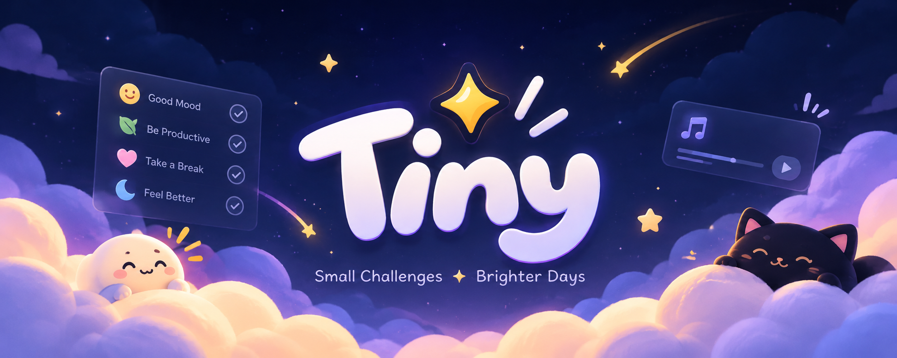

# Tiny

<p align="center">
  
</p>

<p align="center">
  A playful random activity generator for when you are bored and need something fun to do.
</p>

## About

Tiny helps you find a small, interesting challenge without overthinking it. Choose a vibe, set your available time and energy, then get a suggestion you can start immediately.

## Features

- 56 challenges across Create, Code, Think, Friends, Eat, Play, and Outside
- Recommendations by mood, energy, difficulty, and available time
- Surprise-me challenge discovery flow
- Favorites and local completion history
- Daily challenge card
- Active challenge timer with visual countdown ring
- Ambient music stations for lo-fi, rain, and focus sounds
- Notes and reflections after completing challenges
- Responsive desktop and mobile navigation
- Glassmorphism UI with Lavender, Sunset, Ocean, Forest, and Dark themes
- Sora display typography and DM Sans content typography
- Reduced-motion support, keyboard focus states, ARIA labels, and touch-friendly controls

## Tech stack

- React
- TypeScript
- Vite
- Tailwind CSS v4
- Zustand
- Motion
- Lucide React
- Web Audio API
- localStorage

## Getting started

```bash
git clone https://github.com/mryeminaung/tiny.git
cd tiny
pnpm install
pnpm dev
```

Open [http://localhost:3000](http://localhost:3000) in your browser.

## Build for production

```bash
pnpm build
```

## Project structure

```text
src/
├── components/              Shared UI and layout components
│   └── ui/                   Reusable UI primitives
├── features/                Feature-specific components and pages
├── pages/                   Route-level pages
├── stores/                  Zustand application state
├── lib/                     Challenge data, constants, music, and utilities
├── layouts/                 Application layout wrappers
├── assets/fonts/            Local Sora and DM Sans fonts
├── App.tsx                  Router definition
├── main.tsx                 React entry point
└── index.css                Global styles, themes, and accessibility rules
```

## Design direction

Tiny is designed to feel lightweight, playful, and low-pressure. The interface uses colorful backgrounds, soft glass surfaces, expressive typography, and small moments of motion without turning the experience into a productivity dashboard.
